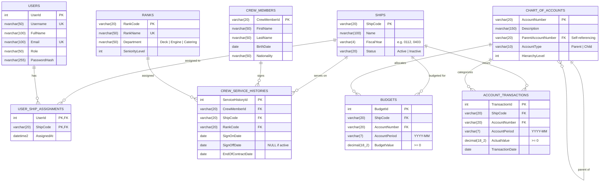

# Anglo-Eastern Ship Management – Backend Solution

[](https://github.com/syawqy/ae-backend-code-challenge/actions/workflows/ci.yml)


Production-ready backend solution for ship management, crew rosters, and hierarchical financial expense reporting. Built with **C# (.NET 8)** and **Microsoft SQL Server (T-SQL)**, adhering strictly to the architectural constraint: **Database access via stored procedures only**.

---

## 1. Architecture & Design Principles

```
┌─────────────────────────────────────────────────────────────┐
│                      REST API Layer                         │
│  (ASP.NET Core Web API, Swagger UI, JWT Bearer Auth)        │
└──────────────┬──────────────────────────────┬───────────────┘
               │                              │
               ▼                              ▼
┌─────────────────────────────┐┌──────────────────────────────┐
│     FluentValidation        ││ Exception Handling Middleware│
│ (Request Boundary Validation││ (RFC 7807 Problem Details)   │
└──────────────┬──────────────┘└──────────────┬───────────────┘
               │                              │
               ▼                              ▼
┌─────────────────────────────────────────────────────────────┐
│              Data Access Layer (Dapper / ADO.NET)           │
│   Strict Contract: Executes T-SQL Stored Procedures ONLY    │
└──────────────────────────────┬──────────────────────────────┘
                               │
                               ▼
┌─────────────────────────────────────────────────────────────┐
│            Microsoft SQL Server (T-SQL Engine)              │
│  - Relational Schema (3NF, Check & Foreign Key Constraints) │
│  - Functions: fn_CalculateAge, fn_GetFiscalYearPeriods      │
│  - Stored Procedures: sp_GetCrewList, sp_GetFinancialReport │
│  - Recursive CTEs for Hierarchical Chart of Accounts Rollup │
└─────────────────────────────────────────────────────────────┘
```

- **Separation of Concerns:** Clean architecture isolating HTTP transport, request validation, business rules, and database execution.
- **Stored Procedure Isolation:** The application contains zero dynamic SQL and zero ORM-generated table queries. Every database operation runs through a dedicated, parameterized stored procedure.
- **Security:** Complete parameterization eliminates SQL injection risks. Dynamic sorting in `sp_GetCrewList` uses compile-time whitelisted `CASE` expressions. Passwords are encrypted using salted BCrypt hashes. Endpoints support JWT Bearer authentication.

---

## 2. Database Design & Entity Relationship Diagram (ERD)

Full architectural details, data dictionaries, and constraints are documented in [`database/ERD.md`](database/ERD.md) and [`database/erd.svg`](database/erd.svg).

### Mermaid ERD



### Key Schema Features
1. **Fiscal Year Constraints:** `CHECK (FiscalYear LIKE '[0-1][0-9][0-1][0-9]')` with sub-string month range checks (`01` through `12`).
2. **Financial Non-Negativity:** `CHECK (BudgetValue >= 0)` and `CHECK (ActualValue >= 0)` prevent negative values.
3. **Date Consistency:** `CHECK (EndOfContractDate >= SignOnDate AND (SignOffDate IS NULL OR SignOffDate >= SignOnDate))` prevents inverted contract dates.
4. **Covering Indexes:** `IX_CrewServiceHistories_Ship_Active`, `IX_Budgets_Ship_Period`, and `IX_AccountTransactions_Ship_Period` provide high performance on multi-ship operational joins.
5. **Rank Exclusivity Enforcement:** Trigger `TR_CrewServiceHistories_NoRankOverlap` actively prevents any overlapping active service dates for identical ranks on the same vessel.

---

## 3. Stored Procedures & Business Logic

Located in [`database/03_stored_procedures.sql`](database/03_stored_procedures.sql):

### A. Crew List (`sp_GetCrewList`)
- **Status Calculation Rule:**
  - `SignOffDate IS NOT NULL` $\to$ Signed Off (excluded from output).
  - `SignOnDate > @AsOfDate` $\to$ Planned (excluded from active operational view).
  - `DATEDIFF(day, EndOfContractDate, @AsOfDate) > 30` $\to$ **Relief Due**.
  - `SignOnDate <= @AsOfDate` $\to$ **Onboard**.
- **Pagination & Sorting:** Parameterized `OFFSET ... FETCH NEXT` with deterministic secondary sort on `CrewMemberId`.
- **Search:** Search across all non-status fields (Rank Name, Crew ID, First Name, Last Name, Age as text, Nationality, formatted date `05 Apr 2025` allowing partial date matches like `05 Apr`).

### B. Financial Reports (`sp_GetFinancialReportDetail` & `sp_GetFinancialReportSummary`)
- **Detailed Report (Period & Hierarchical COA):** Scoped to a specific accounting period (e.g. `2025-07`), returning both parent summary accounts and leaf detail accounts. Uses recursive Common Table Expression (`AccountLeaves`) to roll up child account actuals/budgets to parent summary accounts with monthly and fiscal year YTD variances.
- **Summary Report (YTD Non-COA):** Per client clarification, the summary report is YTD and not specific to any COA. It aggregates total ship spend and budgeted amounts month-by-month across the fiscal year up to the cutoff period, providing cumulative YTD totals and variances without COA breakdown.
- **Fiscal Year YTD Logic:** Encapsulated in table-valued function `dbo.fn_GetFiscalYearPeriods(@FiscalYearCode, @TargetPeriod)`.
  - For `0112` (calendar year): Start period is `YYYY-01`.
  - For `0403` (cross-calendar year): If period month is $\ge 4$, start is `YYYY-04`. If period month is $< 4$ (e.g. `2025-02`), start is `(YYYY-1)-04` (April of previous year).
- **Zero/Null Rule:** Excludes records where both monthly and YTD budget and actual amounts are zero.
---

## 4. API Endpoints

### Authentication
- `POST /api/auth/login` – Authenticates user and returns JWT Bearer token.

### Users
- `GET /api/users` – List all system users.
- `GET /api/users/{id}` – Get user by ID.
- `POST /api/users` – Register new user.
- `GET /api/users/{id}/ships` – Get ships assigned to a specific user.
- `POST /api/users/{id}/ships` – Assign a ship to a user (`{ "shipCode": "SHIP01" }`).

### Ships
- `GET /api/ships` – List all ships (supports `?status=Active` / `Inactive`).
- `GET /api/ships/{code}` – Get ship by code.
- `POST /api/ships` – Register a new ship (`ShipCode`, `Name`, `FiscalYear`, `Status`).
- `GET /api/ships/{code}/users` – Get users assigned to a ship.
- `GET /api/ships/{code}/crew` – Retrieve crew roster with pagination, sorting, search (`?pageNumber=1&pageSize=10&sortColumn=SignOnDate&sortDirection=ASC&searchTerm=Jan&asOfDate=2026-10-28`).
- `GET /api/ships/{code}/financial/detail` – Detailed financial report (`?period=2025-07`).
- `GET /api/ships/{code}/financial/summary` – Summary parent-level financial report (`?period=2025-07`).

---

## 5. Quick Start & Execution Guide

### Option 1: Local Setup (.NET CLI + LocalDB / SQL Server)

1. **Deploy Database & Seed Data:**
   Run SQL Server LocalDB or SQL Server Express:
   ```powershell
   sqlcmd -S "(localdb)\MSSQLLocalDB" -E -i database/01_schema.sql
   sqlcmd -S "(localdb)\MSSQLLocalDB" -E -i database/02_functions.sql
   sqlcmd -S "(localdb)\MSSQLLocalDB" -E -i database/03_stored_procedures.sql
   sqlcmd -S "(localdb)\MSSQLLocalDB" -E -i database/04_sample_data.sql
   ```
2. **Build and Run the Web API:**
   ```bash
   dotnet build ShipManagement.sln
   dotnet run --project src/ShipManagement.Api
   ```
3. **Open Swagger UI:**
   Navigate to `https://localhost:5001` or `http://localhost:5000` in your browser.

---

### Option 2: Docker Compose (All-in-One)

Launch SQL Server 2022, run automated database schema migration, and start the API in Docker:
```bash
docker compose up --build
```
The API is available at `http://localhost:5000`.

---

## 6. Running Tests

The test suite includes 66 unit, domain, validation, and database stored procedure integration tests:
```bash
dotnet test
```

Test breakdown:
- `FiscalYearCalculationTests`: Verifies calendar (`0112`) and cross-calendar (`0403`) periods, boundary months, and year rollovers.
- `CrewStatusCalculationTests`: Verifies Onboard, Relief Due (>30 days overdue), Planned, and Signed Off transitions.
- `AgeCalculationTests`: Validates birthday passed vs. not yet reached.
- `ValidatorTests`: Validates incoming requests, date patterns, regex, ranges, and sort column whitelists.
- `ControllersUnitTests`: Verifies HTTP response codes, DTO mappings, and controller behavior with Moq.
- `StoredProcedureIntegrationTests`: Executes stored procedures directly on SQL Server to verify pagination, search, parent rollups, and YTD calculations.
- `ApiIntegrationTests`: End-to-end integration tests using `WebApplicationFactory<Program>`.
