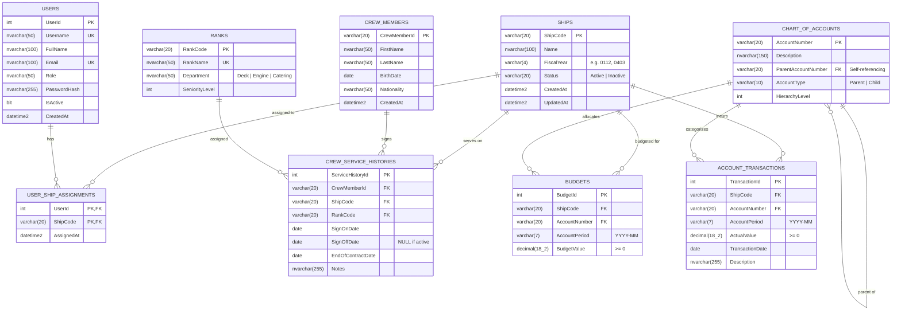

# Entity Relationship Diagram (ERD) & Database Architecture

## Overview
The database schema for Anglo-Eastern Ship Management is designed in Microsoft SQL Server (T-SQL). It implements normalization (3NF), integrity constraints (non-negative financial amounts, date ranges, fiscal year formats), cascading referential integrity where appropriate, and covering indexes for reporting performance.

---

## Mermaid ERD

---

## Entity Descriptions & Data Integrity Rules

### 1. `Ships`
- **Primary Key:** `ShipCode` (e.g. `SHIP01`).
- **FiscalYear:** 4-character code (`0112` = Jan to Dec, `0403` = Apr to Mar). Enforced via regex pattern check and range validation `[01-12]`.
- **Status:** Constrained to `('Active', 'Inactive')`. Only active ships are returned in operational endpoints and crew lists.

### 2. `Users` & `UserShipAssignments`
- Many-to-many relationship allowing users (superintendents, fleet managers, crew coordinators) to be linked to multiple ships.
- `UserShipAssignments` composite PK `(UserId, ShipCode)` with cascading delete.

### 3. `Ranks`, `CrewMembers`, and `CrewServiceHistories`
- `Ranks`: Standard maritime ranks across Deck, Engine, Catering departments.
- `CrewMembers`: Biographical info (First/Last name, BirthDate, Nationality).
- `CrewServiceHistories`: Service contracts per ship with `SignOnDate`, `SignOffDate`, and `EndOfContractDate`.
- **Status Rule (Operational View):**
  - `SignOffDate IS NOT NULL` $\to$ Signed Off
  - `SignOnDate > AsOfDate` $\to$ Planned
  - `SignOffDate IS NULL AND DATEDIFF(day, EndOfContractDate, AsOfDate) > 30` $\to$ **Relief Due**
  - `SignOffDate IS NULL AND SignOnDate <= AsOfDate` $\to$ **Onboard**

### 4. `ChartOfAccounts`, `Budgets`, and `AccountTransactions`
- `ChartOfAccounts`: Hierarchical self-referencing tree structure. Leaf nodes have `AccountType = 'Child'` and summary accounts have `AccountType = 'Parent'`.
- `Budgets` & `AccountTransactions`: Recorded strictly at the child account level. Check constraints guarantee `BudgetValue >= 0` and `ActualValue >= 0`.
- Summary aggregation is computed dynamically via recursive CTEs up through the COA hierarchy.
